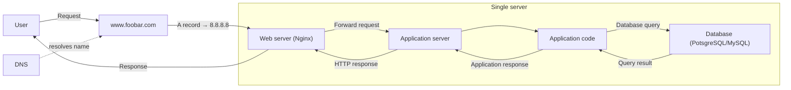
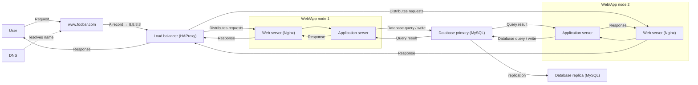

# web_infrastructure_design

---

# Single-server website stack

This diagram shows a request to `www.foobar.com`, resolution to the single server at `8.8.8.8`, processing through the web and application layers, and the response returning to the user. All server-side services sit inside one server boundary and depend on that server.

## The server

A server is a computer that provides resources or services to other computers; it may be a physical machine or a virtual machine. It runs an operating system that manages the machine's resources and supports the software running on it. Servers are commonly hosted in data centers, which provide power, cooling, and network connectivity. The server is the machine and boundary; the web server, application server, application code, and database are distinct services or software layers running on it.

## DNS and the domain

DNS translates a human-readable domain name into an IP address so a client can find the destination server. In this scenario, the `www` host record is an A record because the provided destination, `8.8.8.8`, is an IPv4 address; an A record maps a name to an IPv4 address. The diagram labels this scenario's mapping explicitly.

## Request processing layers

The web server (Nginx) accepts the incoming web request and passes dynamic work to the application server. The application server runs the application code, which implements the site's behavior and reads or writes data through the database. The database stores and retrieves the site's persistent data, then returns query results for the application to form a response.

## Network communication

The user's device and the server communicate across a network using the TCP/IP protocol suite. The request travels to the server and the response travels back over the network.

## LAMP-like design

LAMP stands for Linux, Apache, MySQL (or MariaDB), and PHP (often generalized to include Perl or Python). This design is LAMP-like because it places a web layer, application code, and a database together on one server, but it is not a literal LAMP stack: it uses Nginx rather than Apache, and the diagram does not specify Linux or a particular application language.

## Single-server limitations

The single server is a single point of failure: if it or a critical service on it fails, the website may become unavailable. Maintenance that requires restarting or taking the server offline can cause downtime. The server also has finite CPU, memory, storage, and network capacity, so increased traffic can exceed its capacity and slow or interrupt service.

---

## Redundant web tier

The evolved diagram is in [`redundant_web_tier.mmd`](redundant_web_tier.mmd). It keeps the `www.foobar.com` entry point and shows the DNS A record directing traffic to the HAProxy load balancer at the scenario's `8.8.8.8` address.

The load balancer was added to distribute incoming requests across two equivalent web/application paths. Each path has its own Nginx web server and application server, so one path can continue handling requests if the other path fails; it also adds application-tier capacity. The two paths are **active-active**: both are available to serve requests at the same time. In an **active-passive** design, the standby path would wait while the active path serves traffic, then take over after a failure.

One possible distribution method is **round robin**: the load balancer sends successive requests to each path in turn. The diagram shows both paths receiving traffic, though the distribution policy itself is an implementation choice.

The **database primary** is the writable database that handles the application paths' queries and writes. The **database replica** receives a copy of changes from the primary through the directed replication flow; this diagram does not send writes to the replica or assume automatic failover. A replica may support recovery or read workloads if separately configured, but replication alone does not keep writes available when the primary fails.

The load balancer is a remaining single point of failure because only one is shown. The writable database primary is another single point of failure for database writes. This design also omits HTTPS, firewalls, and monitoring, so those protections and operational visibility are limitations. Redundancy can improve application availability and capacity, but it adds infrastructure, configuration, and operational cost.

---

