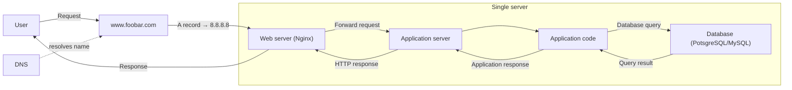
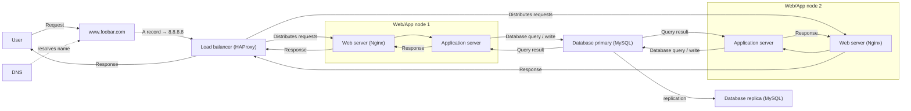
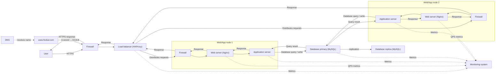
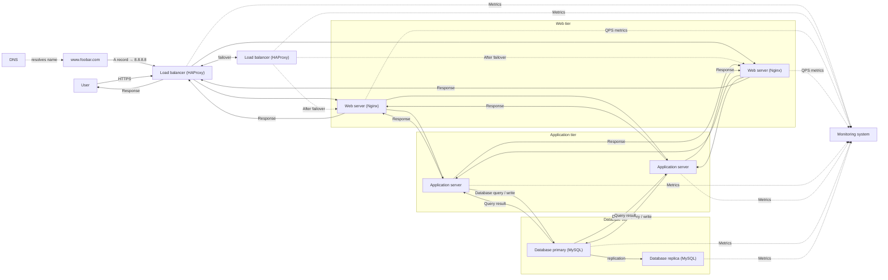

# web_infrastructure_design

---

# Single-server website stack

This diagram shows a request to `www.foobar.com`, resolution to the single server at `8.8.8.8`, processing through the web and application layers, and the response returning to the user. All server-side services sit inside one server boundary and depend on that server.

## The server

A server is a computer that provides resources or services to other computers; it may be a physical machine or a virtual machine. It runs an operating system that manages the machine's resources and supports the software running on it. Servers are commonly hosted in data centers, which provide power, cooling, and network connectivity. The server is the machine and boundary; the web server, application server, application code, and database are distinct services or software layers running on it.

## DNS and the domain

DNS translates a human-readable domain name into an IP address so a client can find the destination server. In this scenario, the `www` host record is an A record because the provided destination, `8.8.8.8`, is an IPv4 address; an A record maps a name to an IPv4 address. The diagram labels this scenario's mapping explicitly.

## Request processing layers

The web server (Nginx) accepts the incoming web request and passes dynamic work to the application server. The application server runs the application code, which implements the site's behavior and reads or writes data through the database. The database stores and retrieves the site's persistent data, then returns query results for the application to form a response.

## Network communication

The user's device and the server communicate across a network using the TCP/IP protocol suite. The request travels to the server and the response travels back over the network.

## LAMP-like design

LAMP stands for Linux, Apache, MySQL (or MariaDB), and PHP (often generalized to include Perl or Python). This design is LAMP-like because it places a web layer, application code, and a database together on one server, but it is not a literal LAMP stack: it uses Nginx rather than Apache, and the diagram does not specify Linux or a particular application language.

## Single-server limitations

The single server is a single point of failure: if it or a critical service on it fails, the website may become unavailable. Maintenance that requires restarting or taking the server offline can cause downtime. The server also has finite CPU, memory, storage, and network capacity, so increased traffic can exceed its capacity and slow or interrupt service.

---

## Redundant web tier

The evolved diagram is in [`redundant_web_tier.mmd`](redundant_web_tier.mmd). It keeps the `www.foobar.com` entry point and shows the DNS A record directing traffic to the HAProxy load balancer at the scenario's `8.8.8.8` address.

The load balancer was added to distribute incoming requests across two equivalent web/application paths. Each path has its own Nginx web server and application server, so one path can continue handling requests if the other path fails; it also adds application-tier capacity. The two paths are **active-active**: both are available to serve requests at the same time. In an **active-passive** design, the standby path would wait while the active path serves traffic, then take over after a failure.

One possible distribution method is **round robin**: the load balancer sends successive requests to each path in turn. The diagram shows both paths receiving traffic, though the distribution policy itself is an implementation choice.

The **database primary** is the writable database that handles the application paths' queries and writes. The **database replica** receives a copy of changes from the primary through the directed replication flow; this diagram does not send writes to the replica or assume automatic failover. A replica may support recovery or read workloads if separately configured, but replication alone does not keep writes available when the primary fails.

The load balancer is a remaining single point of failure because only one is shown. The writable database primary is another single point of failure for database writes. This design also omits HTTPS, firewalls, and monitoring, so those protections and operational visibility are limitations. Redundancy can improve application availability and capacity, but it adds infrastructure, configuration, and operational cost.

---

## Protected and monitored stack

The evolved diagram is in [`protected_monitored_stack.mmd`](protected_monitored_stack.mmd). The domain's A record points to the edge firewall address in this scenario; user traffic reaches the load balancer through that firewall, and the two application paths each have a firewall in front of them. Dashed arrows distinguish one-way metric flows from request and response traffic.

A firewall filters network traffic according to configured rules, allowing or blocking connections between network zones. It can reduce unwanted access, but it does not by itself encrypt traffic, fix vulnerable application code, or guarantee that every attack is stopped; no rules are configured by this diagram.

HTTPS uses TLS to encrypt data in transit and help protect it from eavesdropping or alteration while also authenticating the server when its certificate is properly checked. The diagram marks the user's connection as HTTPS. If TLS terminates at the load balancer, traffic from the load balancer to the web servers may be unencrypted unless TLS encryption continues on those internal hops.

Monitoring clients or agents can collect measurements and status from the load balancer and services, then send that telemetry one way to a monitoring system for storage, display, and analysis. Here the dashed arrows represent those metric flows; the diagram does not install agents or configure alerts. QPS means queries per second (or, more generally, requests per second for a web service). Tracking QPS over time can reveal traffic increases or drops and, alongside latency and resource measurements, help identify when a service is approaching capacity.

The database primary remains the only writable database in this design, so its failure can stop writes even while the web and application paths remain available. The replica receives replication updates, but the diagram does not assume automatic promotion or write availability from the replica.

When web, application, and database services share the same host, they compete for the same CPU, memory, storage, and maintenance window. Scaling one role then means scaling the whole host, and maintenance or a resource problem in one role can affect the others. Separating roles can make scaling and maintenance more independent, at the cost of additional infrastructure and operational work.

---

## Separated tiers

The evolved design is in [`separated_tiers.mmd`](separated_tiers.mmd). It keeps the HTTPS entry, DNS name, and metric flows, while placing web servers, application servers, and databases in distinct tiers. Two HAProxy nodes are connected by a conceptual `failover` relationship; the dashed path from the second node represents traffic after failover, without specifying how failure is detected or traffic is redirected.

In the single-server design, the web server, application server, and database share one server, so one machine failure or maintenance event can affect the whole site. Here the web, application, and database roles are shown in separate tiers, with multiple web and application instances; the database tier still has one writable primary and one replica.

Separate tiers allow capacity to be added where measurements show it is needed: web instances for request handling, application instances for application work, or database resources for data workload. Scaling one tier does not require multiplying every other tier, though each tier must still have enough capacity and suitable connections to its neighbors.

Separation can also reduce the effect of maintenance on unrelated components. For example, a web server can be patched or replaced without taking every application server and the database down with it; similarly, application instances can be updated in batches while other instances continue serving. This benefit depends on the service being able to route around the instance being maintained.

Instance counts should follow measured demand, expected growth, failure tolerance, and a justified safety margin. Copying counts from an illustrative diagram or maximizing instances without evidence can waste money and still fail to address the actual bottleneck.

The database primary remains a write-availability limitation: replication is shown, but automatic database failover and promotion are not designed here. The load-balancer relationship is also conceptual and does not define detection or traffic redirection. Separate tiers and redundant instances improve flexibility but increase infrastructure cost and operational complexity.
