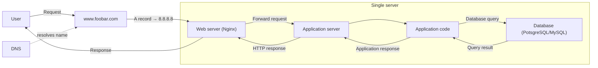

# web_infrastructure_design

---

# Single-server website stack

This diagram shows a request to `www.foobar.com`, resolution to the single server at `8.8.8.8`, processing through the web and application layers, and the response returning to the user. All server-side services sit inside one server boundary and depend on that server.

## The server

A server is a computer that provides resources or services to other computers; it may be a physical machine or a virtual machine. It runs an operating system that manages the machine's resources and supports the software running on it. Servers are commonly hosted in data centers, which provide power, cooling, and network connectivity. The server is the machine and boundary; the web server, application server, application code, and database are distinct services or software layers running on it.

## DNS and the domain

DNS translates a human-readable domain name into an IP address so a client can find the destination server. In this scenario, the `www` host record is an A record because the provided destination, `8.8.8.8`, is an IPv4 address; an A record maps a name to an IPv4 address. The diagram labels this scenario's mapping explicitly.

## Request processing layers

The web server (Nginx) accepts the incoming web request and passes dynamic work to the application server. The application server runs the application code, which implements the site's behavior and reads or writes data through the database. The database stores and retrieves the site's persistent data, then returns query results for the application to form a response.

## Network communication

The user's device and the server communicate across a network using the TCP/IP protocol suite. The request travels to the server and the response travels back over the network.

## LAMP-like design

LAMP stands for Linux, Apache, MySQL (or MariaDB), and PHP (often generalized to include Perl or Python). This design is LAMP-like because it places a web layer, application code, and a database together on one server, but it is not a literal LAMP stack: it uses Nginx rather than Apache, and the diagram does not specify Linux or a particular application language.

## Single-server limitations

The single server is a single point of failure: if it or a critical service on it fails, the website may become unavailable. Maintenance that requires restarting or taking the server offline can cause downtime. The server also has finite CPU, memory, storage, and network capacity, so increased traffic can exceed its capacity and slow or interrupt service.

---

